<div align="center">

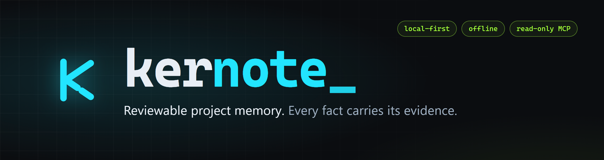

### Your project's memory, with receipts.

Kernote reads a codebase and builds a **cited, evidence-backed model of it**. When the code moves, it tells you
exactly which facts to re-check. It answers questions with sources, or says *"evidence not found."*
It runs on your machine, offline, as a Windows app or from source.

<p>
<a href="https://github.com/pavannithin224-abcd/kernote/actions/workflows/ci.yml"></a>


</p>
<p>


</p>

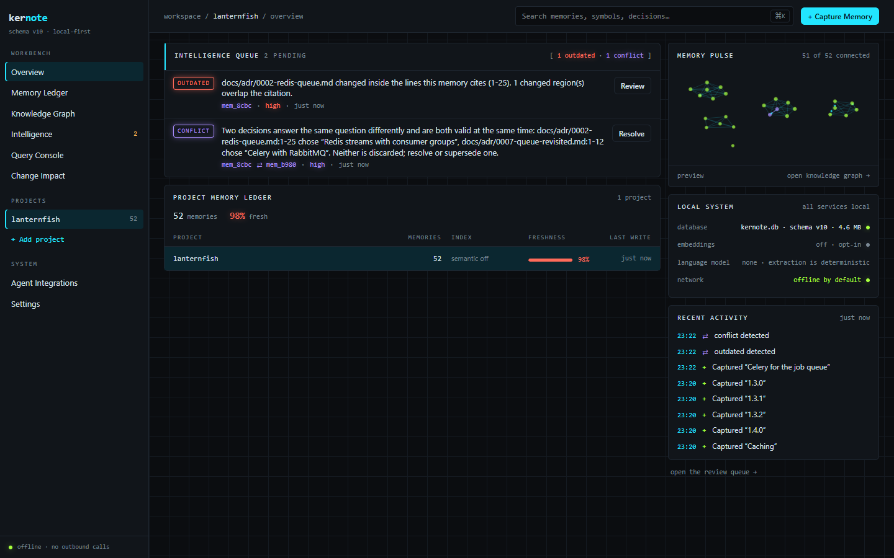
<br>
<sub>A real scan of a sample service, after its docs and code were edited. Kernote noticed both changes. <b>Nothing</b> was merged or marked wrong for you.</sub>

</div>

---

## Two ways in

|  | |
|---|---|
| **[Download the app](../../releases)** | Windows installer, **65 MB**. Per-user, so no admin rights. Double-click, add a folder, done. No Python, no Node, no setup. |
| **Run from source** | `git clone`, one `pip install`, one `npm install`. Same code, scriptable, hackable. [Jump to it.](#run-from-source) |

The installed app and the source checkout run the **same code**. The desktop build is a window around the same
FastAPI service, and the same test suite covers both.

---

## Why it exists

Every team has a document that says one thing and code that does another. Project notes rot silently, and
the fix is never "write more notes", because nobody knows *which* notes just became wrong.

Kernote keeps a **reviewable** model of a project and keeps it honest as the code changes:

- **Every fact carries its evidence**: file, line range, content hash, and full revision history.
- **Every change to the code says which facts to re-check**, pinned to the diff hunk that overlaps the claim, not just "the repo changed."
- **Nothing enters or leaves the vault without you seeing why.** Conflicts are held open, merges need approval, and approvals can be undone.

It is an **audit and review workspace**, not another agent-memory server. See
[how it differs](docs/COMPETITIVE_LANDSCAPE.md).

---

## See it work

<div align="center">
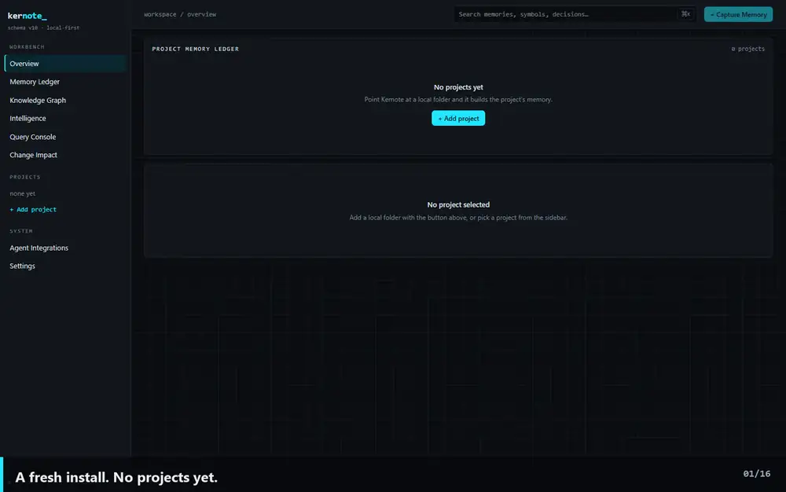
<br>
<sub>A real capture: <b>46 seconds</b>, from an empty install to drift and a held-open contradiction. Not a mock-up. Smaller file: <a href="docs/demo.mp4"><code>docs/demo.mp4</code></a>.</sub>
</div>

<details>
<summary><b>The original 19-second pitch</b></summary>
<br>
<div align="center">

<br>
<sub><b>Illustrative.</b> The question and citations in this teaser are made up for the video, not output from a real vault. The walkthrough above is the real thing. <a href="docs/brag.mp4"><code>brag.mp4</code></a> has sound (music: <i>Wisps of Whorls</i> by <a href="https://incompetech.com">Kevin MacLeod</a>, <a href="http://creativecommons.org/licenses/by/4.0/">CC BY 4.0</a>).</sub>
</div>
</details>

---

## What it does

### 1. Add a project in one step

Pick a folder. Kernote registers it, reads it **read-only** in the background (the window never freezes), then checks the result for drift, conflicts and duplicates.

<div align="center">
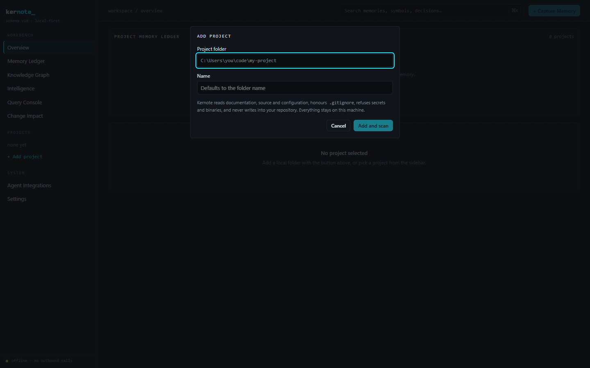
<br>
<sub>The scanner honours <code>.gitignore</code>, refuses secrets and binaries, never writes into your repository, and explains every file it skipped.</sub>
</div>

### 2. Ask a question. Get evidence, or an honest "I don't know"

Kernote does not write an answer. **There is no language model in the loop.** It returns the records that bear on your question, each quoted from its source with a citation.

<div align="center">
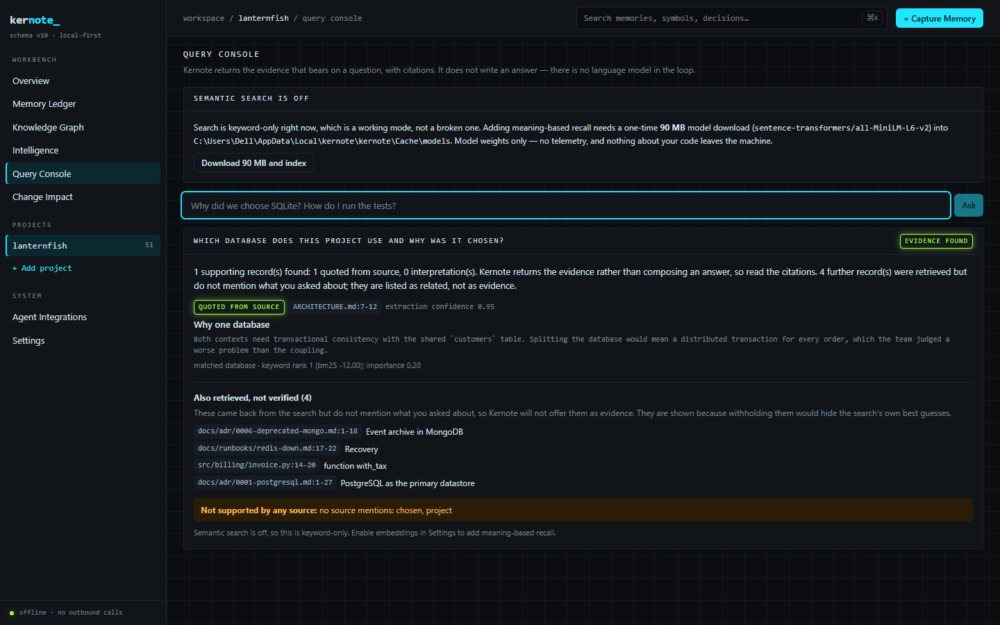
<br>
<sub>The reason, quoted from <code>ARCHITECTURE.md:7-12</code>. Four weaker matches are shown, but labelled <i>not verified</i> rather than offered as proof.</sub>
</div>

<br>

When nothing in the project answers the question, it says so. Candidates are shown as **leads, not answers**:

<div align="center">
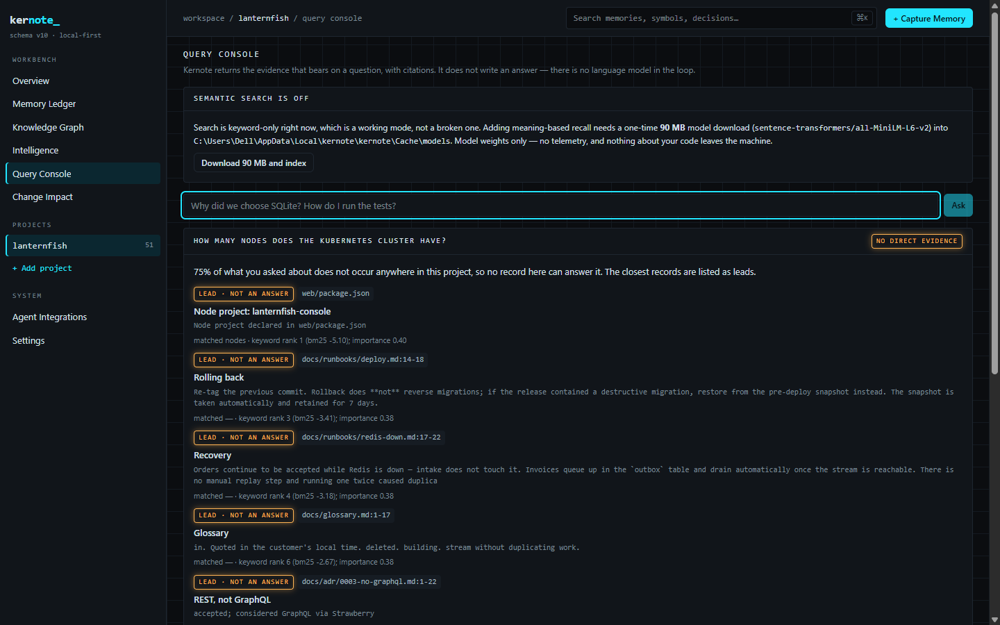
<br>
<sub>"75% of what you asked about does not occur anywhere in this project." Declining is a feature, so it is designed and measured, not an error state.</sub>
</div>

### 3. Know exactly what went stale, and why

When a cited file changes, Kernote shows the **overlapping diff hunk** that triggered the concern. When two sources disagree, **both claims stay visible** with their origins until you resolve it. It never silently picks a winner.

<div align="center">
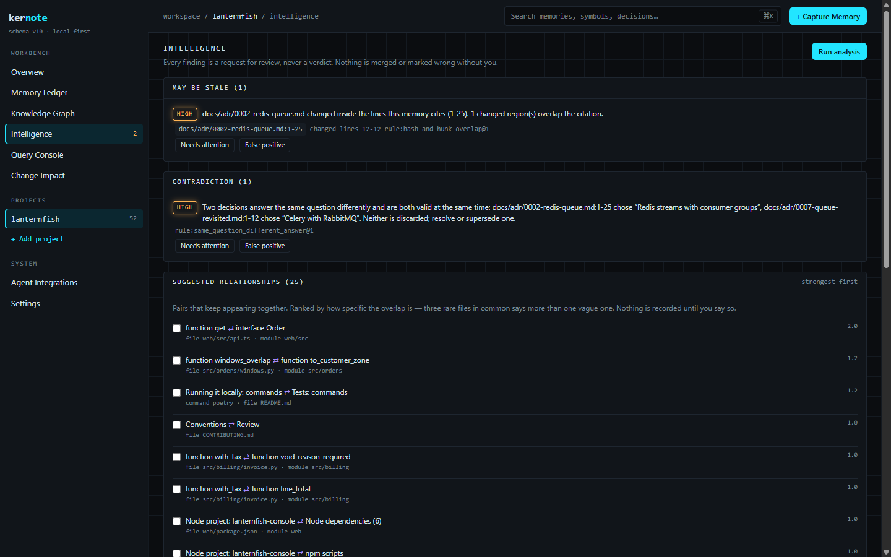
<br>
<sub>A decision reversed in one document and contradicted in another. Findings are requests for review, <b>never verdicts</b>.</sub>
</div>

### 4. See what a commit puts at risk

<div align="center">
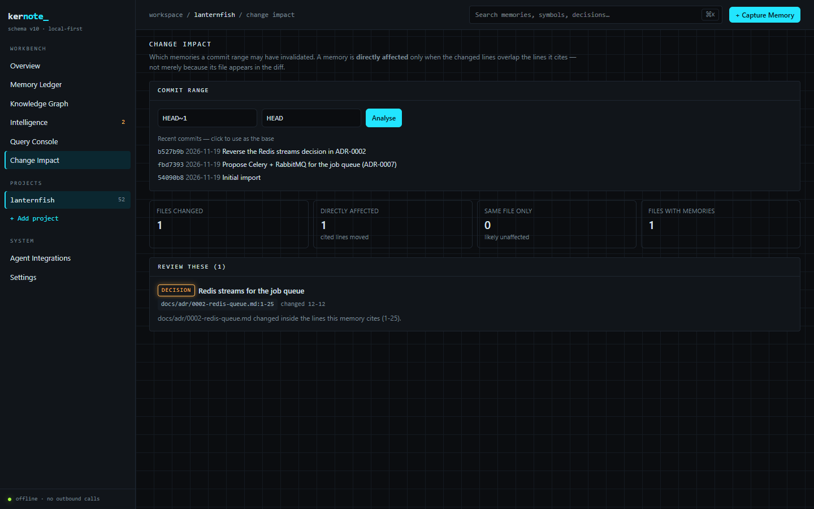
<br>
<sub>A memory is <b>directly affected</b> only when the changed lines overlap the lines it cites, not merely because its file appears in the diff. That is the difference between a useful signal and noise.</sub>
</div>

### 5. See how it all connects

<div align="center">
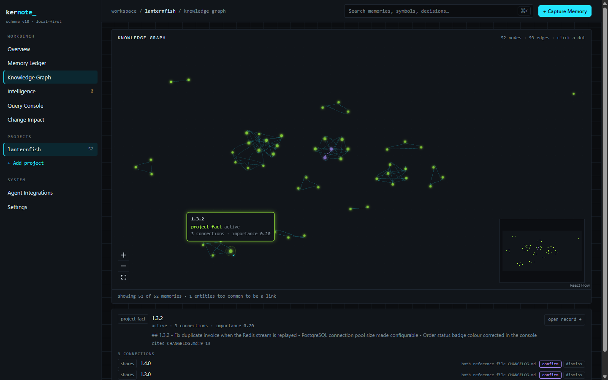
<br>
<sub>Every dot is a memory. Every line is a row in the database, either a link you confirmed or a shared entity. Nothing is drawn that cannot be explained.</sub>
</div>

### 6. Hand reviewed memory to your coding agent

Kernote serves approved memory over a **read-only MCP server**. There is no write tool in any form, so an agent can use your project's decisions but cannot change them.

<div align="center">
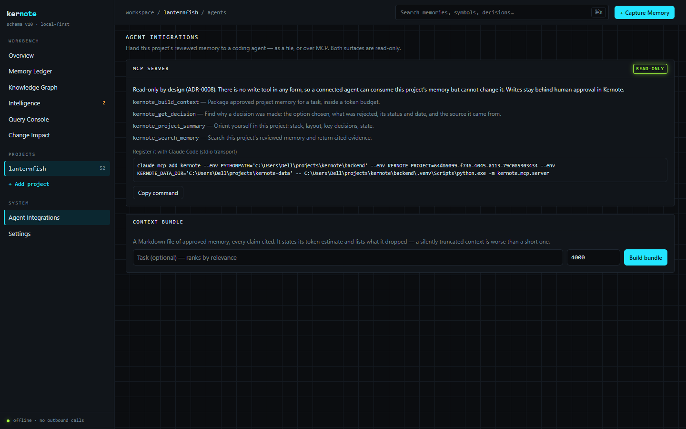
<br>
<sub>The screen generates the exact registration command for <i>your</i> install and project, with a <b>Copy</b> button.</sub>
</div>

---

## How it works

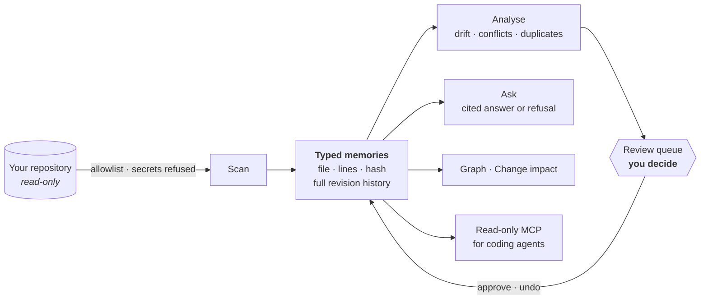

Seven memory types (fact, architecture, decision, procedure, convention, gotcha, current state), each with
**provenance down to the line** and a lifecycle. Extraction is deterministic and rule-based. Code symbols come
from tree-sitter for Python, TypeScript, TSX and JavaScript. Markdown and `pyproject.toml` / `package.json` /
`requirements.txt` manifests are parsed everywhere. Retrieval is SQLite FTS5 (BM25), optionally fused with local
MiniLM embeddings by reciprocal rank. Full design: [ARCHITECTURE](docs/ARCHITECTURE.md), [MEMORY_MODEL](docs/MEMORY_MODEL.md).

---

## Install

### The app (Windows)

Tested on **Windows 11**. (Windows 10 needs the Microsoft WebView2 runtime, which up-to-date systems already have.)

Download `Kernote-Setup-0.1.0.exe` from [Releases](../../releases) and run it. It installs **per-user**
(`%LOCALAPPDATA%\Programs\Kernote`), so Windows never asks for admin rights, and it adds a Start Menu entry.
Verify the download first if you like:

```powershell
Get-FileHash Kernote-Setup-0.1.0.exe -Algorithm SHA256
```

> **Heads-up: the installer is not code-signed yet.** Signing needs a purchased certificate, and Windows
> SmartScreen will show *"Unknown publisher"* until there is one. Check the SHA-256 against the release notes, then
> choose **More info → Run anyway**. This is stated up front because a security tool should not hide it.

**Uninstalling removes the program but never your data.** The vault lives in `%LOCALAPPDATA%\kernote\kernote`, and the
uninstaller tells you where it is so you can delete it yourself if you want it gone.

### Run from source

<details open>
<summary><b>Windows, macOS or Linux</b>: Python 3.12+, Node 20+, Git 2.40+</summary>

```bash
git clone https://github.com/pavannithin224-abcd/kernote.git
cd kernote

python -m venv backend/.venv
backend/.venv/bin/pip install -r backend/requirements-dev.txt     # Windows: backend\.venv\Scripts\pip

npm --prefix frontend install
npm --prefix frontend run build
```

Run it as one process on one port, then open <http://127.0.0.1:8787>:

```bash
KERNOTE_CORS_ORIGINS='[]' backend/.venv/bin/python -m uvicorn kernote.main:app --app-dir backend --port 8787
```

On Windows PowerShell, set the variable first: `$env:KERNOTE_CORS_ORIGINS='[]'`.

Or in its own window (needs `pip install -r backend/requirements-desktop.txt`):

```bash
cd backend && .venv/bin/python -m kernote.desktop
```

With [`just`](https://github.com/casey/just): `just app` serves it, `just desktop` opens the window, `just dev` runs hot-reload
(API on :8787, UI on :5173), and `just ci` runs lint, tests and the build.

</details>

Build the Windows installer yourself: `npm --prefix frontend run build`, then `pyinstaller kernote.spec`, then compile
[`packaging/kernote.iss`](packaging/kernote.iss) with [Inno Setup 6](https://jrsoftware.org/isinfo.php). The spec builds both
`kernote.exe` (windowed) and `kernote-mcp.exe` (console, because MCP over stdio needs stdin and stdout).

---

## Use it with a coding agent

The Agent Integrations screen prints the exact command. From the installed app it looks like this:

```powershell
claude mcp add kernote --env KERNOTE_PROJECT=<project-id> --env KERNOTE_DATA_DIR=<vault-dir> -- "C:\Users\<you>\AppData\Local\Programs\Kernote\kernote-mcp.exe"
```

Four tools, all read-only: `kernote_search_memory`, `kernote_get_decision`, `kernote_project_summary`, `kernote_build_context`
(a Markdown bundle of approved memory inside a **token budget**, which states what it dropped). The server is verified against a
real MCP client over stdio, **including the installed `kernote-mcp.exe`**. Claude Code is the only agent it has been
driven from so far.

---

## Choosing what gets scanned

Kernote reads documentation, source and configuration under a built-in allowlist, honours `.gitignore`, and explains every
file it skipped. To adjust it, commit a `.kernote.toml` to the repository root:

```toml
[scan]
include = ["data/schemas/**/*.json", "deploy/*.yaml"]
exclude = ["vendor/**", "docs/generated/**"]
```

The asymmetry is deliberate: **exclude always beats include**, include widens only the allowlist, and **nothing in a repo can
talk Kernote into reading a private key**. A config file inside a repository is untrusted input. `.gitignore` is always
respected, with no switch to disable it. Settings shows the effective configuration with its provenance.

---

## Measured, not claimed

| | |
|---|---|
| Tests | **572** backend tests: **559 pass**, 13 skip (they need the optional 90 MB embedding model or the eval extras, which CI deliberately does not install). CI runs them on **Windows and Linux** |
| Quality gates | `ruff` · `tsc -b` · `eslint` · `npm audit` (0) · `pip-audit` (0) |
| Shipped dependency advisories | **0**. (The previous pins carried 93; see [SECURITY.md](SECURITY.md).) |
| Installer | **65 MB**, per-user, no admin |
| UI bundle | 329 kB (100 kB gzip); the graph loads on demand |
| Retrieval, labelled set | Recall@5 **0.80** keyword-only, **0.98** with semantic search on · useful abstention **83%** · citation correctness **43%** / **55%** (keyword / semantic) ([EVALUATION](docs/EVALUATION.md)) |
| On a real repository | declines **4 of 4** unanswerable questions |

Retrieval is **extractive**: it competes on whether the citations are correct and the abstentions honest, not on fluency.
Those numbers come from a 31-question labelled set and are reproduced by the **Run evaluation** button in Settings. They are
not a marketing figure.

---

## Privacy and safety

- **Local-first.** No telemetry, no accounts, no outbound calls by default. The one optional download (the ~90 MB embedding model for
  semantic search) is opt-in, says what leaves the machine, and sends model weights only.
- **Web pages cannot talk to it.** Requests with a non-loopback `Host` (DNS rebinding) or a cross-origin write are refused.
  Tested. See [SECURITY.md](SECURITY.md) for the full threat model *and what it does not cover*.
- **Destructive actions are guarded.** Restore and project removal require explicit confirmation and take a safety snapshot first.
  Routine backup pruning never touches those snapshots. Removing a project **never touches your folder**.
- **Read-only agent surface.** The MCP server registers no write tool.

---

## Honest limitations

- **Unsigned installer.** SmartScreen will warn (see above).
- **Extraction is rule-based**, so recall is lower than an LLM pipeline would give. A model adapter is optional and additive ([ADR-0006](docs/DECISIONS.md)).
- **Symbol extraction** covers Python, TypeScript, TSX and JavaScript. Other languages are stored as text.
- **Paraphrased questions** can miss: on 24% of answerable questions it finds the right document but declines to call it an answer
  ([ADR-0032](docs/DECISIONS.md)). When it declines, it shows leads rather than hiding them.
- **No batch approval** for consolidations yet (relationship links have it), so clearing a big duplicate backlog is one request each.
- **Never checked with a real screen reader.** Structure, labels, focus and contrast are covered by automated guards; that is not the same thing.
- **One agent tested** over MCP (Claude Code).
- **Semantic search is opt-in** (a one-time ~90 MB download). Its end-to-end path was last exercised on the previous embedding library version; the unit-level API is verified compatible with the current one.
- **The packaged MCP helper prints a harmless traceback to stderr at shutdown.** Exit code 0, protocol clean, no orphan processes.

---

## Documentation

| Document | What is in it |
|---|---|
| [PRODUCT_SPEC](docs/PRODUCT_SPEC.md) | Problem, users, features with priorities, acceptance criteria |
| [ARCHITECTURE](docs/ARCHITECTURE.md) | Process shape, modules, API surface, full SQLite schema, security boundaries |
| [MEMORY_MODEL](docs/MEMORY_MODEL.md) | The four data layers, nine lifecycle stages, record design, invariants |
| [DECISIONS](docs/DECISIONS.md) | ADRs with alternatives and consequences |
| [EVALUATION](docs/EVALUATION.md) | Measured retrieval quality |
| [COMPETITIVE_LANDSCAPE](docs/COMPETITIVE_LANDSCAPE.md) | Who else ships this, and where the real gap is |
| [SECURITY](SECURITY.md) | Threat model, what is and is not defended |
| [DEV_HANDOFF](docs/DEV_HANDOFF.md) | Current state, what is verified and what is not |
| [CLAUDE.md](CLAUDE.md) | The project contract for Claude Code |

`Kernote` is a **provisional working name** pending trademark, domain and registry clearance ([spec §9](docs/PRODUCT_SPEC.md)).
The mark in [`design/logo/`](design/logo/) needs the same clearance before public use.

## License

MIT. See [LICENSE](LICENSE).
